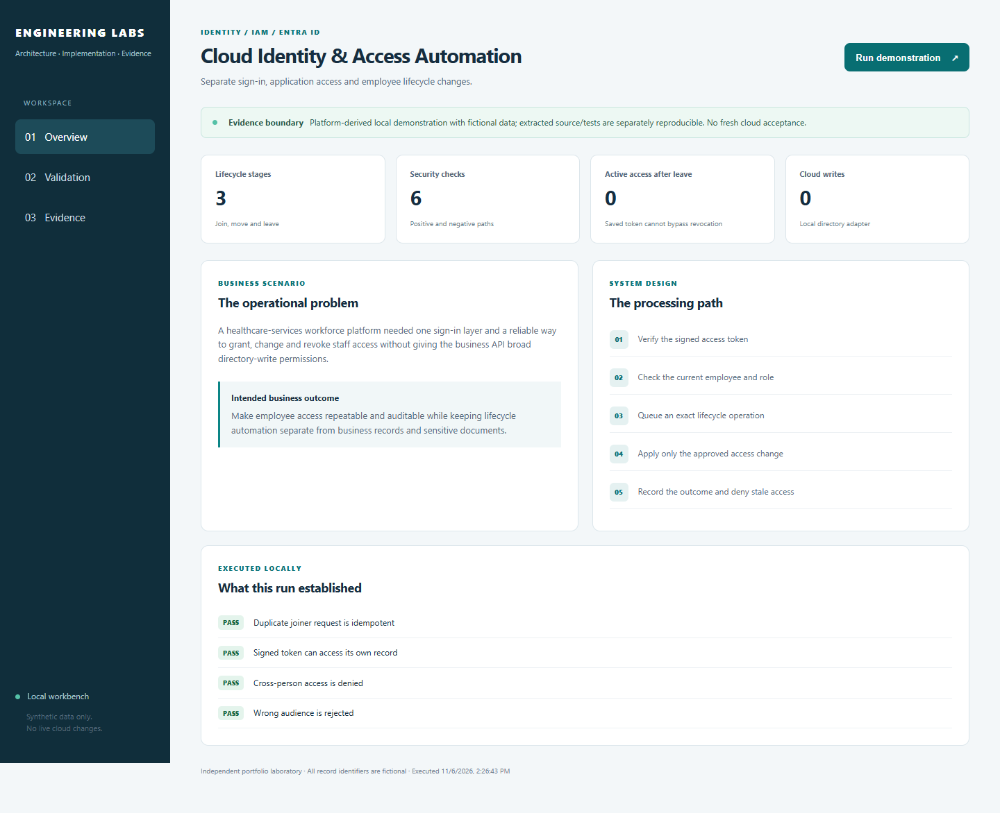
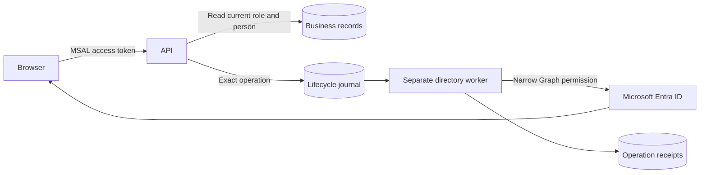
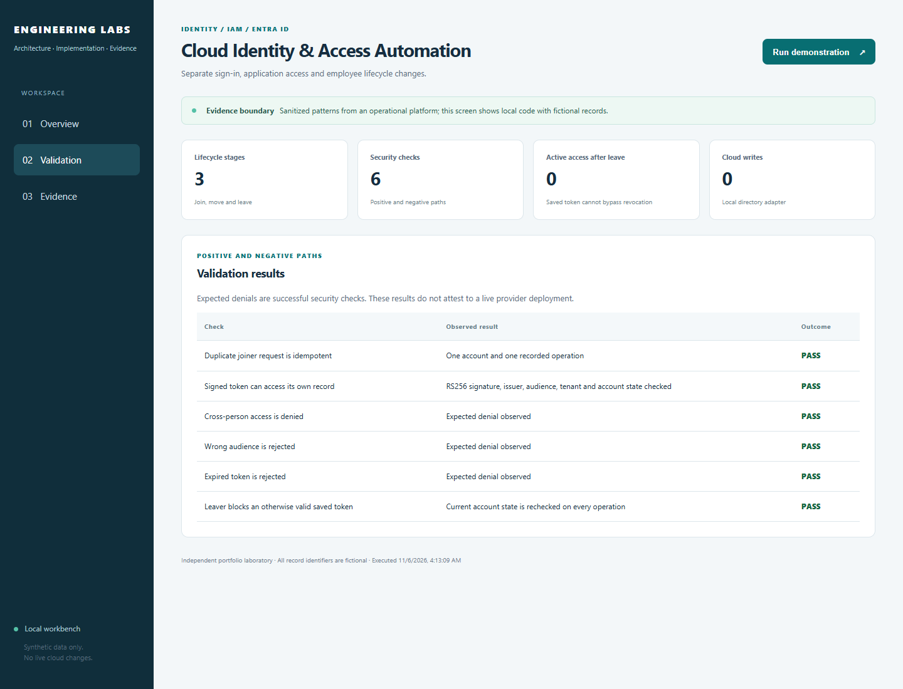

# Cloud Identity & Access Automation

**Give people the access they need, and remove it reliably when their role changes.**

[The problem](#the-business-problem) · [The solution](#the-solution) · [What was built](#what-was-built) · [Proof it works](#proof-it-works) · [Run it](#run-it-locally)



## The Business Problem

Employees join, change jobs and leave. Signing in does not automatically mean a person should see every record or change directory accounts. Repeated or interrupted access changes also need clear results so staff do not repeat an action blindly.

## The Solution

Use Microsoft Entra for sign-in, check permissions on the server, and handle account changes in a separate background service. Match each action to the correct person and record its result. Use cloud-issued service identities where appropriate to reduce stored credentials.

**Business outcome:** Make employee access changes repeatable and reviewable while keeping account administration separate from business records and sensitive documents.

### Platform implementation

- Configured Microsoft Entra as the authentication layer for a Node.js operational platform, with app registrations, audience/tenant validation and application roles.
- Separated a dedicated non-HTTP directory worker from the business API so directory-writing permissions did not belong to the public business service.
- Implemented bounded joiner/mover/leaver operations with exact-person binding, saved results and readback. Password-reset automation remained disabled rather than being represented as accepted.
- Used managed identities and GitHub OIDC for service/deployment access, reducing reliance on stored cloud credentials.

This case study draws on a workforce/operations platform I designed and implemented. Organization details and records are excluded. The public code makes selected patterns reproducible; the screenshots show a working local demonstration with fictional data. [Validation scope](docs/VALIDATION.md) separates that evidence from testing against the actual cloud service.

### Actual implementation code

This repository now includes selected implementation source and original tests from the operational platform, rather than only a portable reference. Read [what was implemented and accepted](docs/IMPLEMENTATION.md), [the source map](docs/SOURCE-MAP.md) and the dated validation boundaries. Identifying configuration is replaced with examples; original private history and records are excluded.

## Architecture



## What Was Built

| Component | Role in plain words | Implementation |
| --- | --- | --- |
| Actual identity boundaries | Dedicated worker, exact linked account, current staff eligibility and app-only roles | [Extracted source](reference/) · [implementation](docs/IMPLEMENTATION.md) |
| Entra groups and app roles | Map six staff access groups to an existing API, with an explicit group owner. | [View code](infra/groups.tf) |
| Separate managed identities | Keep API, directory-worker and deployment identities distinct. | [View code](infra/main.tf) |
| Optional GitHub OIDC trust | Accept one reviewed workload subject; federation remains Off by default. | [View code](infra/main.tf) |
| Signed-token reference | Check RSA signature, issuer, audience, tenant and token lifetime using local fixture keys. | [View code](lab/domain.py) |
| Lifecycle journal | Make duplicate joiner requests idempotent and apply current-state access checks. | [View code](lab/domain.py) |
| Positive and negative tests | Exercise ownership, role removal, leaver access and duplicate worker requests. | [View code](tests) |

## Proof It Works

### Extracted platform code

```bash
npm run test:source
```

The selected original tests run offline. [Validation](docs/VALIDATION.md) records current counts and distinguishes them from historical hosted evidence.


**Current local checks:** 7 extracted-source tests + 16 portable tests passed · 6 demonstration checks · 2 Terraform tests using simulated cloud responses.

These are dated results for this reference implementation, not live Azure/AWS deployment claims. [Test record](docs/validation-results.json) · [Evidence and limitations](docs/VALIDATION.md)

### 1. Duplicate requests do not create duplicate work

Separate worker connections submit the same request key. The tests observe one stored operation and revision.

Run from the repository root:

```bash
python -B -m unittest discover -s tests -p test_concurrency.py -v
```

**What to look for:** One operation is stored even when separate worker connections submit the same request.

### 2. Wrong access is rejected

Wrong-audience, expired-token, incorrect-signature and cross-person requests are rejected by the reference.

Run from the repository root:

```bash
python -B -m unittest discover -s tests -p test_domain.py -v
```

**What to look for:** The test file exercises valid access plus wrong-audience, expired, invalid-signature and ownership denials.

### 3. Old tokens cannot bypass a leaver change

The local authorization adapter reads current account state. A previously valid token no longer grants access after the employee is inactive.

Run from the repository root:

```bash
python -B -m unittest discover -s tests -p test_domain.py -k leaver -v
```

**What to look for:** The leaver case passes because current account state denies the saved token.

### 4. Visible results

The dashboard runs the same domain code as the CLI. Desktop/mobile rendering, all three tabs, rerunning the demonstration, cross-origin write rejection and unlisted-file rejection were checked. The screenshots are captured from those runs.



Expected access denials are successful negative tests. Cloud permissions, network connectivity and provider integrations need their own acceptance evidence.

## Security Practices

- The business API and privileged worker have different identities. The example does not grant Microsoft Graph write permissions.
- Tokens are checked before permission checks for the specific record; a valid signature alone does not authorize another employee's record.
- OIDC trust and tenant/subscription inputs are explicit. No client secret, real directory ID, token or production state is included.

State, saved Terraform plans, private inputs and credentials are excluded through [`.gitignore`](.gitignore). The existing validation workflow is manual-only and has no cloud deployment permission.

## Run It Locally

The [command reference](docs/COMMANDS.md) includes prerequisites, Windows equivalents, focused checks and evidence notes.

Requires Python 3.12 or newer and the pinned cryptography dependency. Run inside a virtual environment:

```bash
python -m venv .venv
source .venv/bin/activate
python -m pip install -r requirements.txt
python -B -m unittest discover -s tests -v
python -B -m lab demo
python -B -m lab serve --port 8011
```

On Windows, use `.venv\Scripts\Activate.ps1` instead of the `source` command, or run `.venv\Scripts\python.exe` directly. Open [the local workbench](http://127.0.0.1:8011), choose **Run demonstration**, then review **Validation** and **Evidence**. Stop with Ctrl+C. No cloud login, employee data or paid API request is required.

## Terraform Infrastructure

Entra security groups and API app-role assignments, separate API/directory/deployment managed identities, and an optional exact-subject GitHub federated credential.

See the [Terraform code and validation steps](infra/README.md), [input example](infra/example.tfvars.example) and [mock plan tests](infra/tests). Cloud commissioning and any paid resources remain separate from the local demonstration.

Validate the infrastructure source without creating cloud resources:

```bash
cd infra
terraform init -backend=false
terraform fmt -check -recursive
terraform validate
terraform test
```

The tests use mock providers. Example inputs are placeholders, not deployment-ready values. Review the [integration boundaries and cost notes](infra/README.md) before any separate cloud commissioning.

## Scaling and Tradeoffs

Serialize lifecycle work per person, use a shared durable journal and monitor unknown provider outcomes. A real directory timeout requires readback before retrying; a local SQLite transaction cannot undo a remote Graph operation.

See [strengths, weaknesses and tradeoffs](docs/SCALING.md) for the detailed decisions.

## Skills Demonstrated

- Microsoft Entra ID and application authorization
- Joiner/mover/leaver automation
- Managed identities and exact-subject OIDC federation
- Least privilege and ownership checks
- Idempotency and concurrent worker testing

## Project Guides

| Guide | What you will find |
| --- | --- |
| [Command reference](docs/COMMANDS.md) | Copy the commands, understand their purpose and check expected results |
| [Implementation walkthrough](docs/WALKTHROUGH.md) | Follow the processing path and code |
| [Architecture](docs/ARCHITECTURE.md) | Understand service and identity boundaries |
| [Terraform](infra/README.md) | Read the resource map, input examples and integration steps |
| [Validation evidence](docs/VALIDATION.md) | Inspect dated checks and their limits |
| [Operations and troubleshooting](docs/OPERATIONS.md) | Diagnose failures and recover safely |
| [Security and privacy](SECURITY.md) | Review access, secrets and publication controls |
| [Scaling and tradeoffs](docs/SCALING.md) | Understand the costs of each design choice |
| [References](docs/REFERENCES.md) | See technical sources and presentation inspiration |

## Repository Map

`reference/` contains extracted implementation logic and original selected tests.


```text
infra/               Terraform source, example inputs and mock plan tests
lab/                 Working reference implementation and loopback dashboard
tests/               Positive, negative and recovery cases
docs/                Architecture, walkthrough, evidence and operating guide
.github/workflows/   Manual-only contract validation; no cloud deployment
```

## Cost and Cleanup

The default local demo creates only temporary local state and makes no paid calls. Cloud examples are separate opt-in source and can create billable resources if an operator applies them. No automated deployment or destruction is configured. Use `git status --short --ignored` before cleanup; remove only your own `.venv` or disposable lab output. Never copy real state files, tokens or employee documents into this repository.
