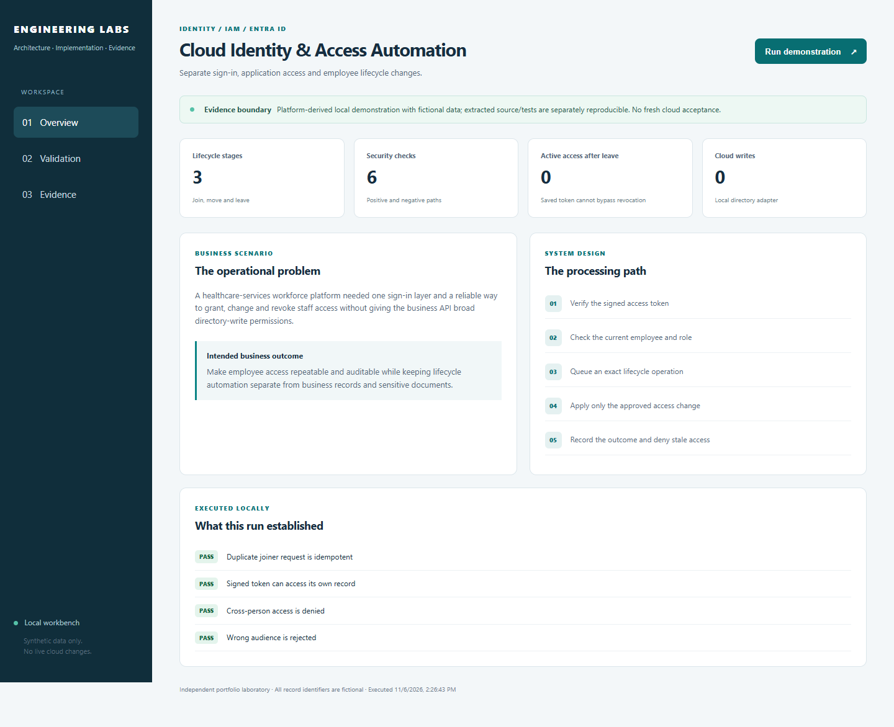
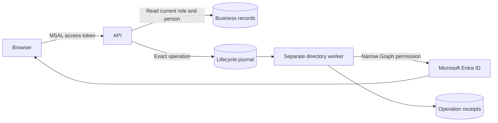
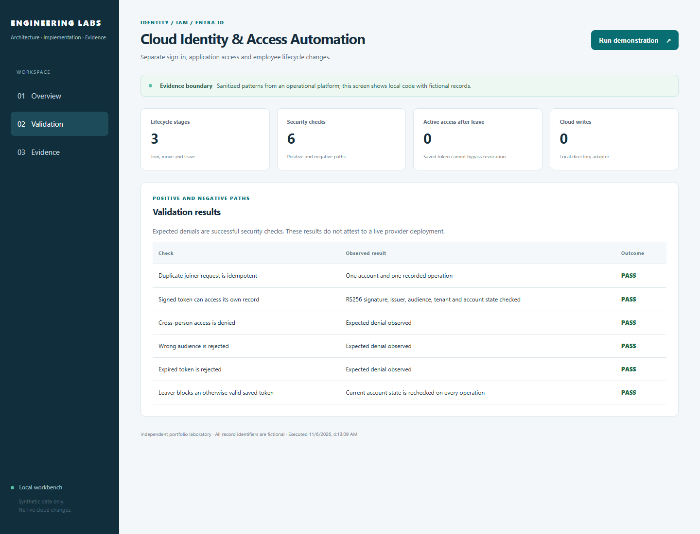

# Cloud Identity & Access Automation

**Give people the access they need, and remove it reliably when their role changes.**

[The problem](#the-business-problem) · [The solution](#the-solution) · [What was built](#what-was-built) · [Proof it works](#proof-it-works) · [Run it](#run-it-locally) · [Step by step](#step-by-step)



## The Business Problem

HR's employee records and the organization's Microsoft accounts describe related parts of the same person's working life. A new employee needs an account and appropriate access; a job change can alter responsibilities; a departure requires access to be reviewed and removed. Handling these as disconnected tasks creates room for delayed setup or retained access.

A successful Microsoft sign-in also leaves business questions unanswered: which employee record belongs to this person, which team may they review and which documents may they open? An interrupted account update can leave the operator unsure whether to repeat it. Giving the public business API broad directory-writing powers would increase the consequences of a mistake.

The business need was a traceable employee-access process that keeps account administration separate from everyday application requests and makes repeated or uncertain changes safe to investigate.

## The Solution

Use Microsoft Entra for sign-in, check permissions on the server, and handle account changes in a separate background service. Match each action to the correct person and record its result. Use cloud-issued service identities where appropriate to reduce stored credentials.

**Business outcome:** Make employee access changes repeatable and reviewable while keeping account administration separate from business records and sensitive documents.

### Platform implementation

- Configured Microsoft Entra as the authentication layer for a Node.js operational platform, with app registrations, audience/tenant validation and application roles.
- Separated a dedicated non-HTTP directory worker from the business API so directory-writing permissions did not belong to the public business service.
- Implemented bounded joiner/mover/leaver operations with exact-person binding, saved results and readback. Password-reset automation remained disabled rather than being represented as accepted.
- Used managed identities and GitHub OIDC for service/deployment access, reducing reliance on stored cloud credentials.

This case study draws on a workforce/operations platform I designed and implemented. Organization details and records are excluded. The public code makes selected patterns reproducible; the screenshots show a working local demonstration with fictional data. [Validation scope](docs/VALIDATION.md) separates that evidence from testing against the actual cloud service.

### Actual implementation code

This repository now includes selected implementation source and original tests from the operational platform, rather than only a portable reference. Read [what was implemented and accepted](docs/IMPLEMENTATION.md), [the source map](docs/SOURCE-MAP.md) and the dated validation boundaries. Identifying configuration is replaced with examples; original private history and records are excluded.

## Tools Used and What They Do

| Tool or service | What it does | Where it fits |
| --- | --- | --- |
| Microsoft Entra ID | Provide staff identity, application roles and workload identities. | Actual identity layer; a job title is not an access role. |
| Microsoft Graph | Carry out the directory changes owned by the dedicated worker. | Actual integration boundary; the public demo does not change accounts. |
| MSAL | Support the frontend’s Microsoft sign-in/token acquisition. | Application context; not the server’s token-verification library. |
| jose | Verify access-token cryptography in the selected server adapter. | Reference adapter; default tests do not contact Entra or its key endpoints. |
| Node.js and TypeScript | Run the worker/API rules and selected source tests. | Actual implementation excerpts. |
| Terraform | Describe identity and scoped infrastructure boundaries. | Reference configuration and local checks; no directory grants are applied. |
| Python, SQLite and cryptography | Run the local identity/recovery illustration and its test data. | Public reference tools; SQLite is not the hosted workforce database. |

Managed identities authenticate workloads to approved services; they do not automatically provide Graph permissions, SQL grants or a network path.

## Step by Step

Your own Entra joiner/leaver lab using two fictional accounts, a reviewed CSV and exact account-ID cleanup.

[Open the standalone build guide](docs/BUILD-YOUR-OWN.md) or follow the same complete instructions below.

Start with a new folder, your own files and your own accounts. The numbered steps below describe the build; no portfolio repository checkout is required. The existing implementation/evidence elsewhere in this repository is a separate reference, not a claim that your new build has already passed.

### Prerequisites

A separate test Entra tenant/domain you administer, Microsoft Graph PowerShell and permission for the selected user lifecycle operations. Do not use real employees or a production-wide identity feed.

Use Bash on Linux/macOS/WSL for Bash blocks and PowerShell for PowerShell blocks. Select the tool versions supported by the official sources below, record the versions you actually install and retain generated dependency locks. Cloud resources, scanner downloads, logs and external AI calls can create costs; review the stated scope before enabling them.

### Create your project folder

Choose a new folder name. These first commands create a blank project; an optional `git init` gives it its own history. Create parent directories in your editor when a later step introduces a nested file.

```bash
mkdir my-cloud-identity-access-automation
cd my-cloud-identity-access-automation
git init
```

Create `.gitignore` before saving credentials or build outputs:

```gitignore
.venv/
node_modules/
.env
.env.*
local.settings.json
credentials.json
token.json
*.pem
*.key
*.tfstate*
*.tfplan
.terraform/
private*/
captures/
backups/
batch.json
reports/
out/
app-config.local.yaml
```

The source/file snippets are a starting implementation you type or paste into the named files. Replace `YOUR_*`, names, regions and addresses only with values from your own lab; do not place real client/employee records in a test project. Keep your terminal in this project root unless a step explicitly changes directory.

Before a first commit, set your own repository-local author with `git config user.name "YOUR_NAME"` and `git config user.email "YOUR_PUBLIC_COMMIT_EMAIL"`. Review `git status --short` and the staged diff before publishing; ignored local files are not a substitute for reviewing what you upload.

### Step 1 — Define the lifecycle input

**Where:** Your new project folder.

Choose your test tenant's verified domain and create users.csv below with unique fictional names. Define creation, disabling and deletion as distinct steps; a job title must not silently grant an administrator role.

Create **`users.csv`** with the following contents:

```csv
UserPrincipalName,DisplayName,MailNickname
lab.joiner01@YOUR_VERIFIED_DOMAIN,Lab Joiner One,lab.joiner01
lab.joiner02@YOUR_VERIFIED_DOMAIN,Lab Joiner Two,lab.joiner02
```

**Check before continuing:** The CSV identifies only the two accounts you intend to create.

### Step 2 — Inspect the input before connecting

**Where:** PowerShell in your folder.

Import the CSV and reject missing/duplicate user principal names. Review the two rows manually and replace the placeholder domain before making any directory request.

```powershell
$rows = Import-Csv -LiteralPath ./users.csv
if ($rows.Count -ne 2) { throw 'Expected exactly two lab rows' }
if ($rows | Where-Object { -not $_.UserPrincipalName -or -not $_.DisplayName }) { throw 'Missing field' }
if ($rows | Group-Object UserPrincipalName | Where-Object Count -gt 1) { throw 'Duplicate user' }
if ($rows.UserPrincipalName -match 'YOUR_VERIFIED_DOMAIN') { throw 'Replace the lab domain' }
$domain = Read-Host 'Your verified isolated test-tenant domain'
$allowed = @("lab.joiner01@$domain", "lab.joiner02@$domain")
if ($domain -notmatch '^[a-zA-Z0-9.-]+$') { throw 'Invalid domain syntax' }
if ($rows | Where-Object { $_.UserPrincipalName -notin $allowed }) { throw 'Unexpected account outside the two-user lab' }
$rows | Select-Object UserPrincipalName, DisplayName
```

**Check before continuing:** The proposed lifecycle scope is exactly your two fictional users.

### Step 3 — Connect with the required test authority

**Where:** Your PowerShell session and Entra consent.

Create lab-context.ps1 below, install the Graph Users module and connect to your exact test tenant. The helper checks the tenant and delegated scope; the signed-in operator must also hold the appropriate directory role for the two fictional accounts.

Create **`lab-context.ps1`** with the following contents:

```powershell
function Assert-LabContext {
    param([Parameter(Mandatory=$true)][guid]$TenantId)
    $context = Get-MgContext
    if (-not $context -or $TenantId -eq [guid]::Empty -or $context.TenantId -ne $TenantId.ToString()) {
        throw 'Stop: the Graph session is not the selected test tenant'
    }
    if ($context.AuthType -ne 'Delegated' -or $context.Scopes -notcontains 'User.ReadWrite.All') {
        throw 'Stop: the required delegated test context is missing'
    }
}
```

```powershell
Install-Module Microsoft.Graph.Users -Scope CurrentUser
. ./lab-context.ps1
$expectedTenant = 'YOUR_TEST_TENANT_ID'
if ($expectedTenant -eq 'YOUR_TEST_TENANT_ID') { throw 'Replace the test tenant ID first' }
try { $parsedTenant = [guid]$expectedTenant } catch { throw 'Use the test tenant GUID, not a name/domain' }
if ($parsedTenant -eq [guid]::Empty) { throw 'The test tenant must not be empty' }
$expectedTenant = $parsedTenant.ToString()
Connect-MgGraph -TenantId $expectedTenant -Scopes 'User.ReadWrite.All' -ContextScope Process
Assert-LabContext -TenantId $expectedTenant
```

**Check before continuing:** The context shows your intended tenant and permission scope.

### Step 4 — Create one controlled test account at a time

**Where:** The same PowerShell session.

Run the context guard immediately before creating a selected row. Retain each successful returned ID in the private CSV below; if creation succeeds but local journaling fails, reconcile that exact UPN in the same tenant and audit logs before retrying, and never adopt a pre-existing account for cleanup.

```powershell
Assert-LabContext -TenantId $expectedTenant
$row = $rows[0] # Deliberately select the second reviewed row only when ready.
$existing = Get-MgUser -Filter "userPrincipalName eq '$($row.UserPrincipalName)'"
if ($existing) { throw 'Account exists; reconcile the prior outcome instead of creating/adopting it' }
$secure = Read-Host 'Temporary password for this fictional user' -AsSecureString
$password = [System.Net.NetworkCredential]::new('', $secure).Password
try {
    $created = New-MgUser -AccountEnabled:$true -DisplayName $row.DisplayName `
      -UserPrincipalName $row.UserPrincipalName -MailNickname $row.MailNickname `
      -PasswordProfile @{Password=$password;ForceChangePasswordNextSignIn=$true} -ErrorAction Stop
} finally {
    $password = $null
    $secure = $null
}
New-Item -ItemType Directory -Path ./private-state -Force | Out-Null
$created | Select-Object Id, UserPrincipalName | Export-Csv `
  -LiteralPath ./private-state/created-users.csv -NoTypeInformation -Append
$created | Select-Object Id, UserPrincipalName
```

**Check before continuing:** Each returned ID corresponds to one reviewed fictional row.

### Step 5 — Exercise the leaver boundary

**Where:** Your recorded exact test account ID.

Recheck the test tenant, select an ID saved by this lab and compare its current UPN with the private journal before disabling it. Test downstream membership/session/application effects separately; the directory field alone does not prove immediate token revocation.

```powershell
Assert-LabContext -TenantId $expectedTenant
$createdIds = Import-Csv -LiteralPath ./private-state/created-users.csv
$targetId = 'YOUR_CREATED_LAB_USER_ID'
$target = @($createdIds | Where-Object Id -eq $targetId)
if ($target.Count -ne 1) { throw 'Select exactly one ID recorded by this lab' }
$actual = Get-MgUser -UserId $targetId -Property Id,UserPrincipalName,AccountEnabled
if ($actual.UserPrincipalName -ne $target[0].UserPrincipalName) { throw 'Recorded user does not match' }
Update-MgUser -UserId $targetId -AccountEnabled:$false
Get-MgUser -UserId $targetId -Property Id,UserPrincipalName,AccountEnabled
```

**Check before continuing:** The selected user is disabled and unrelated accounts are unchanged.

### Step 6 — Capture evidence and remove only your test identities

**Where:** Entra audit logs and your private ID record.

Inspect the actual create/disable events and save a value-free lifecycle diagram. Remove the two exact created test IDs only when finished, disconnect Graph and retain no password or token in your public project.

**Check before continuing:** You can explain request → validation → authorized directory operation → readback → audit evidence.

### Verification and your own screenshots

| Evidence | What to record | Your result |
| --- | --- | --- |
| New build | Your own files/resource settings and tool versions | Not yet recorded |
| Working path | The actual successful request, configuration or recovery result | Not yet recorded |
| Failure boundary | A meaningful denied, malformed, stale or failed case | Not yet recorded |
| Recovery / cleanup | What you restored or removed and what remains billed | Not yet recorded |

Capture your own architecture/configuration, one working result and one failure/recovery result. Keep tokens, credentials, personal records and private identifiers out of public screenshots. Existing portfolio images are references, not evidence that you performed these steps.

### Troubleshooting order

1. Confirm the named file, working directory and selected tool/interpreter.
2. Check the exact input and resource/account selected for the failing step.
3. Separate identity permission, network/DNS reachability and application validation.
4. Keep the actual error and reconcile an unknown write outcome before repeating it; do not widen access or repeat paid operations blindly.

The numbered steps describe a build procedure. Local syntax checks, an accepted API request, a completed hosted operation and a human verification are different evidence levels; fill in the verification table with what you actually observed.

### Official implementation references

- [learn.microsoft.com — get-started](https://learn.microsoft.com/en-us/powershell/microsoftgraph/get-started)
- [learn.microsoft.com — users-lifecycle-workflow-overview](https://learn.microsoft.com/en-us/entra/identity/users/users-lifecycle-workflow-overview)
- [learn.microsoft.com — get-mgcontext?view=graph-powershell-1.0](https://learn.microsoft.com/en-us/powershell/module/microsoft.graph.authentication/get-mgcontext?view=graph-powershell-1.0)

The walkthrough layout follows the prerequisites → creation/configuration → test → verification → troubleshooting → cleanup pattern of the [Splunk project reference](https://github.com/davidharris6/splunk-siem-log-analysis). Its Splunk-specific settings are not copied into unrelated projects.

<details>
<summary>Reference: how the existing platform implementation operates</summary>

A short walkthrough of the process, with technical instructions and evidence limits in the sections below.

1. **Verify the signed-in person (Entra and jose)** — Microsoft Entra handles sign-in while the server checks the received identity and permissions. The application links actions to the correct employee account.

2. **Request the account change** — An authorized action asks for a joiner, role change or leaver operation. The server checks the current record before accepting it.

3. **Use the separate identity worker (Microsoft Graph)** — A dedicated background service performs the permitted account operation. Its directory permissions stay separate from the public business server.

4. **Confirm and record the outcome** — The process reads back the relevant result and saves its operating record. Duplicate requests and changed eligibility must not silently repeat an account change.

</details>

## Architecture



## What Was Built

| Component | Role in plain words | Implementation |
| --- | --- | --- |
| Actual identity boundaries | Dedicated worker, exact linked account, current staff eligibility and app-only roles | [Extracted source](reference/) · [implementation](docs/IMPLEMENTATION.md) |
| Entra groups and app roles | Map six staff access groups to an existing API, with an explicit group owner. | [View code](infra/groups.tf) |
| Separate managed identities | Keep API, directory-worker and deployment identities distinct. | [View code](infra/main.tf) |
| Optional GitHub OIDC trust | Accept one reviewed workload subject; federation remains Off by default. | [View code](infra/main.tf) |
| Signed-token reference | Check RSA signature, issuer, audience, tenant and token lifetime using local fixture keys. | [View code](lab/domain.py) |
| Lifecycle journal | Make duplicate joiner requests idempotent and apply current-state access checks. | [View code](lab/domain.py) |
| Positive and negative tests | Exercise ownership, role removal, leaver access and duplicate worker requests. | [View code](tests) |

## Proof It Works

### Extracted platform code

```bash
npm run test:source
```

The selected original tests run offline. [Validation](docs/VALIDATION.md) records current counts and distinguishes them from historical hosted evidence.


**Current local checks:** 7 extracted-source tests + 16 portable tests passed · 6 demonstration checks · 2 Terraform tests using simulated cloud responses.

These are dated results for this reference implementation, not live Azure/AWS deployment claims. [Test record](docs/validation-results.json) · [Evidence and limitations](docs/VALIDATION.md)

### 1. Duplicate requests do not create duplicate work

Separate worker connections submit the same request key. The tests observe one stored operation and revision.

Run from the repository root:

```bash
python -B -m unittest discover -s tests -p test_concurrency.py -v
```

**What to look for:** One operation is stored even when separate worker connections submit the same request.

### 2. Wrong access is rejected

Wrong-audience, expired-token, incorrect-signature and cross-person requests are rejected by the reference.

Run from the repository root:

```bash
python -B -m unittest discover -s tests -p test_domain.py -v
```

**What to look for:** The test file exercises valid access plus wrong-audience, expired, invalid-signature and ownership denials.

### 3. Old tokens cannot bypass a leaver change

The local authorization adapter reads current account state. A previously valid token no longer grants access after the employee is inactive.

Run from the repository root:

```bash
python -B -m unittest discover -s tests -p test_domain.py -k leaver -v
```

**What to look for:** The leaver case passes because current account state denies the saved token.

### 4. Visible results

The dashboard runs the same domain code as the CLI. Desktop/mobile rendering, all three tabs, rerunning the demonstration, cross-origin write rejection and unlisted-file rejection were checked. The screenshots are captured from those runs.



Expected access denials are successful negative tests. Cloud permissions, network connectivity and provider integrations need their own acceptance evidence.

## Identity Logs in the Security Workspace

Native Entra audit and interactive sign-in logs already reach the hub security workspace. The November 14 seven-day sample contained 34 audit rows and 20 interactive sign-in rows; these are records, not unique people or complete authentication coverage.

Other inspected sign-in categories were not enabled and had no rows. Verifying arrivals did not activate new identity detectors or change account permissions. [Identity collection and its limits](docs/IDENTITY-OBSERVABILITY.md) distinguishes sign-in evidence, Azure resource-role changes and the separate application security path.

## Security Practices

- The business API and privileged worker have different identities. The example does not grant Microsoft Graph write permissions.
- Tokens are checked before permission checks for the specific record; a valid signature alone does not authorize another employee's record.
- OIDC trust and tenant/subscription inputs are explicit. No client secret, real directory ID, token or production state is included.

State, saved Terraform plans, private inputs and credentials are excluded through [`.gitignore`](.gitignore). The existing validation workflow is manual-only and has no cloud deployment permission.

## Run It Locally

The [command reference](docs/COMMANDS.md) includes prerequisites, Windows equivalents, focused checks and evidence notes.

Requires Python 3.12 or newer and the pinned cryptography dependency. Run inside a virtual environment:

```bash
python -m venv .venv
source .venv/bin/activate
python -m pip install -r requirements.txt
python -B -m unittest discover -s tests -v
python -B -m lab demo
python -B -m lab serve --port 8011
```

On Windows, use `.venv\Scripts\Activate.ps1` instead of the `source` command, or run `.venv\Scripts\python.exe` directly. Open [the local workbench](http://127.0.0.1:8011), choose **Run demonstration**, then review **Validation** and **Evidence**. Stop with Ctrl+C. No cloud login, employee data or paid API request is required.

## Terraform Infrastructure

Entra security groups and API app-role assignments, separate API/directory/deployment managed identities, and an optional exact-subject GitHub federated credential.

See the [Terraform code and validation steps](infra/README.md), [input example](infra/example.tfvars.example) and [mock plan tests](infra/tests). Cloud commissioning and any paid resources remain separate from the local demonstration.

Validate the infrastructure source without creating cloud resources:

```bash
cd infra
terraform init -backend=false
terraform fmt -check -recursive
terraform validate
terraform test
```

The tests use mock providers. Example inputs are placeholders, not deployment-ready values. Review the [integration boundaries and cost notes](infra/README.md) before any separate cloud commissioning.

## Scaling and Tradeoffs

Serialize lifecycle work per person, use a shared durable journal and monitor unknown provider outcomes. A real directory timeout requires readback before retrying; a local SQLite transaction cannot undo a remote Graph operation.

See [strengths, weaknesses and tradeoffs](docs/SCALING.md) for the detailed decisions.

## Skills Demonstrated

- Microsoft Entra ID and application authorization
- Joiner/mover/leaver automation
- Managed identities and exact-subject OIDC federation
- Least privilege and ownership checks
- Idempotency and concurrent worker testing

## Troubleshooting Lessons

Successful sign-in did not prove the application could execute its SQL statement. Runtime-identity testing exposed a narrow permission gap without requiring a broader role. [Read the incident, evidence and verification](docs/LESSONS-LEARNED.md).

## Project Guides

| Guide | What you will find |
| --- | --- |
| [Command reference](docs/COMMANDS.md) | Copy the commands, understand their purpose and check expected results |
| [Implementation walkthrough](docs/WALKTHROUGH.md) | Follow the processing path and code |
| [Architecture](docs/ARCHITECTURE.md) | Understand service and identity boundaries |
| [Terraform](infra/README.md) | Read the resource map, input examples and integration steps |
| [Validation evidence](docs/VALIDATION.md) | See the test dates, results and limits |
| [Operations and troubleshooting](docs/OPERATIONS.md) | Diagnose failures and recover safely |
| [Security and privacy](SECURITY.md) | Review access, secrets and publication controls |
| [Scaling and tradeoffs](docs/SCALING.md) | Understand the costs of each design choice |
| [References](docs/REFERENCES.md) | See technical sources and presentation inspiration |

## Repository Map

`reference/` contains extracted implementation logic and original selected tests.


```text
infra/               Terraform source, example inputs and mock plan tests
lab/                 Working reference implementation and loopback dashboard
tests/               Positive, negative and recovery cases
docs/                Architecture, walkthrough, evidence and operating guide
.github/workflows/   Manual-only contract validation; no cloud deployment
```

## Cost and Cleanup

The default local demo creates only temporary local state and makes no paid calls. Cloud examples are separate opt-in source and can create billable resources if an operator applies them. No automated deployment or destruction is configured. Use `git status --short --ignored` before cleanup; remove only your own `.venv` or disposable lab output. Never copy real state files, tokens or employee documents into this repository.
