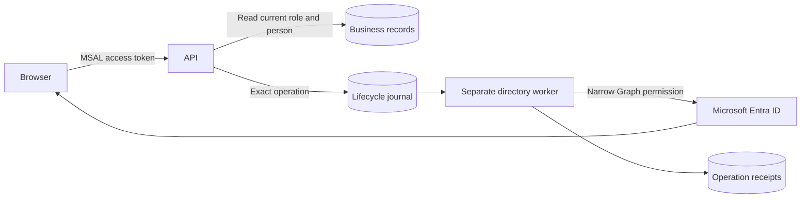

# Cloud Identity & Access Automation

**Separate sign-in, application access and employee lifecycle changes.**


## Business scenario

A healthcare-services workforce platform needed one sign-in layer and a reliable way to grant, change and revoke staff access without giving the business API broad directory-write permissions.

**Business goal:** Make employee access repeatable and auditable while keeping lifecycle automation separate from business records and sensitive documents.

## Engineering context

This project distills work I designed and implemented for an Azure-based workforce and operations platform. The organization, people, cloud resource names and records have been anonymized. The public code extracts selected decisions into a runnable reference; it is not a copy of the private production system.

- Configured Microsoft Entra as the authentication layer for a Node.js operational platform, with app registrations, audience/tenant validation and application roles.
- Separated a dedicated non-HTTP directory worker from the business API so directory-writing permissions did not belong to the public business service.
- Implemented bounded joiner/mover/leaver operations with exact-person binding, stored outcomes and readback. Password-reset automation remained disabled rather than being represented as accepted.
- Used managed identities and GitHub OIDC for service/deployment access, reducing reliance on stored cloud credentials.

The screenshots are captured from this repository's working **local demonstration with fictional data**. They are not cloud-portal screenshots or claims that a visitor has provisioned these resources. [Evidence and scope](docs/VALIDATION.md) distinguishes implemented platform patterns, local tests and cloud work not commissioned here.

## Architecture



## Terraform infrastructure

Entra security groups and API app-role assignments, separate API/directory/deployment managed identities, and an optional exact-subject GitHub federated credential.

See the [Terraform code and validation steps](infra/README.md), [input example](infra/example.tfvars.example) and [mock plan tests](infra/tests). Cloud commissioning and any paid resources remain separate from the local demonstration.

## Run it

Requires Python 3.12 or newer. The identity example also installs its pinned cryptography dependency. Run inside a virtual environment:

```bash
python -m venv .venv
source .venv/bin/activate
python -m pip install -r requirements.txt
python -B -m unittest discover -s tests -v
python -B -m lab demo
python -B -m lab serve --port 8011
```

On Windows, use `.venv\Scripts\Activate.ps1` instead of the `source` command, or run `.venv\Scripts\python.exe` directly. Open [the local workbench](http://127.0.0.1:8011), choose **Run demonstration**, then review **Validation** and **Evidence**. Stop with Ctrl+C. No cloud login, employee data or paid API request is required.

## Validation and failure handling


Expected security denials count as successful negative tests. The implementation walkthrough explains what each check demonstrates and where the hosted-system boundary begins.

| Read next | Purpose |
| --- | --- |
| [Implementation walkthrough](docs/WALKTHROUGH.md) | Follow the code, business decision and failure case |
| [Architecture](docs/ARCHITECTURE.md) | Understand trust boundaries and cloud integration |
| [Validation evidence](docs/VALIDATION.md) | See actual local results and untested boundaries |
| [Security and privacy](SECURITY.md) | Review permissions, secrets and publication controls |
| [Operations and troubleshooting](docs/OPERATIONS.md) | Diagnose failures and clean up safely |
| [Scaling and tradeoffs](docs/SCALING.md) | Decide when to change the design |
| [Sources and presentation credits](docs/REFERENCES.md) | Technical references and README inspiration |

## Repository map

```text
infra/               Terraform source, example inputs and mock plan tests
lab/                 Working reference implementation and loopback dashboard
tests/               Positive, negative and recovery cases
docs/                Architecture, walkthrough, evidence and operating guide
.github/workflows/   Manual-only contract validation; no cloud deployment
```

## Cost and cleanup

The default local demo creates only temporary local state and makes no paid calls. Cloud examples are separate opt-in source and can create billable resources if an operator applies them. No automated deployment or destruction is configured. Use `git status --short --ignored` before cleanup; remove only your own `.venv` or disposable lab output. Never copy real state files, tokens or employee documents into this repository.
