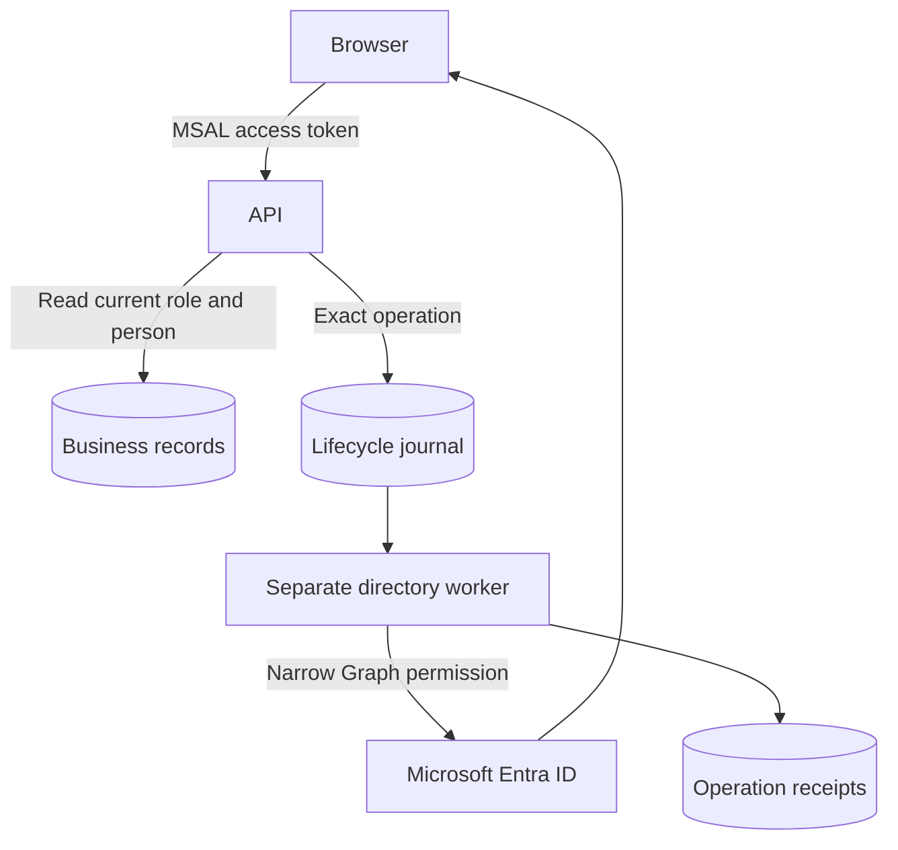

# Architecture and implementation boundaries

## Source-platform context

A healthcare-services workforce platform needed one sign-in layer and a reliable way to grant, change and revoke staff access without giving the business API broad directory-write permissions.

- Configured Microsoft Entra as the authentication layer for a Node.js operational platform, with app registrations, audience/tenant validation and application roles.
- Separated a dedicated non-HTTP directory worker from the business API so directory-writing permissions did not belong to the public business service.
- Implemented bounded joiner/mover/leaver operations with exact-person binding, stored outcomes and readback. Password-reset automation remained disabled rather than being represented as accepted.
- Used managed identities and GitHub OIDC for service/deployment access, reducing reliance on stored cloud credentials.

## Processing path

## Portable reference boundary

This repository keeps the decision logic small enough to inspect and run. SQLite, temporary files and modeled network decisions replace cloud-side resources where stated. No production identifiers or original employee records are included. The browser dashboard is a loopback-only demonstration, not a hosted multi-user application.

The public implementation borrows the source platform's responsibilities and failure lessons. It does not claim byte-for-byte equality with the Node.js/Azure implementation. Changes of language or backing store are explicitly reference adaptations.

## Trust boundaries

1. Treat user input, scan events and imported files as untrusted data.
2. Validate identity, resource ownership and exact source/version before changing state.
3. Keep privileged workers and deployment identities separate from business API permissions.
4. Preserve failed and unknown outcomes; do not turn absence of evidence into a success.
5. Keep secrets in a managed secret store or local environment, never in Git or screenshots.

## Before a hosted deployment

Review the caller matrix, identity permissions, durable state, concurrency, log redaction and recovery path. Run actual provider integration tests in an isolated environment. Separately review cost, data retention, DNS and rollback. The manual CI validates local contracts only and has no cloud identity or deployment permission.

## Included Terraform

Entra security groups and API app-role assignments, separate API/directory/deployment managed identities, and an optional exact-subject GitHub federated credential. See [the code map, resource inventory and integration boundaries](../infra/README.md). This public root does not provision every box in the application diagram.
